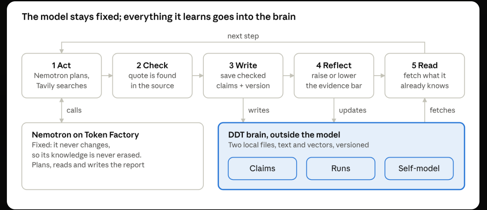

# The DDT vision

DDT, the Digital-Digital Twin, is a digital twin of an AI agent, built inside the agent's own digital environment. It is not a twin of a physical thing. It is an attempt at continual learning that never changes the model's weights.

## The idea in five sentences

1. The model stays fixed, so nothing it already knows can be overwritten.
2. Everything the agent learns goes into a twin beside the model: memory, context, state, tools and a metacognitive layer, each stored as vectors with readable text.
3. Before acting, the twin predicts the run; after acting, it measures its own error.
4. The metacognitive layer asks of every finding, "Is it actually true?", and decides what gets written, protected or merged.
5. Every run is one version of the twin, so the latest runs can be undone.

The picture shows the loop of the first, simpler version (tag `simple-verified`). The vision adds context, state, tools and the metacognitive layer to the brain, as the table below maps.

## Which kind of twin

Standard definitions (ISO/IEC 30173:2023, the Digital Twin Consortium) describe a digital twin of a real-world thing, kept in sync with it. DDT turns this inward: the twin mirrors the agent's own knowledge and behaviour. In Kritzinger's terms it is a twin, not a model or a shadow, because data flows automatically both ways: each run updates the twin, and the twin changes the next run.

## The vision, mapped to the code

| Part of the vision | In DDT | Store | Stored as |
| --- | --- | --- | --- |
| Memory | Checked claims | `brain.jsonl`, `brain.npy` | vector + text |
| Context | One episode per run: question, parts, claims used, outcome, prediction and error | `episodes.jsonl`, `episodes.npy` | vector + text |
| State | Open gaps: parts of a question that no checked claim answers yet | `gaps.jsonl`, `gaps.npy` | vector + text |
| Tools | Every search query with its yield | `tools.jsonl`, `tools.npy` | vector + text |
| Metacognitive layer | The self-model (an evidence bar per topic) and a 6-weight online model that predicts whether a claim will pass, updated after every check | `selfmodel.json`, `metacog.json` | numbers + a weight vector |
| Inner environment | Predict before acting, compare after | inside each episode | numbers |

NVIDIA Nemotron on Nebius Token Factory plans, drafts and writes. Tavily reads the web. Neither of them changes.

For what this shows about continual learning, and what it does not, see [CONTINUAL-LEARNING.md](CONTINUAL-LEARNING.md).

Written by Claude (Cowork) from Hasnat's ideation notes, 18 October 2026.
